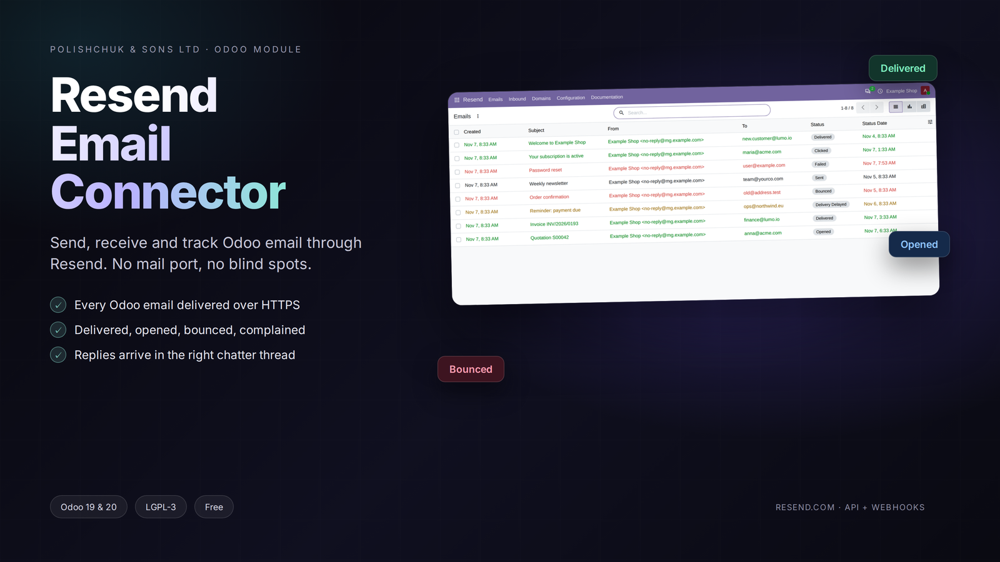

# Odoo Resend Email Connector

Public repository of the Resend Email Connector module for Odoo 19.0 and 20.0.

The module sends Odoo email through [Resend](https://resend.com), receives incoming
mail from Resend and keeps the delivery status of every message on the Odoo record.

* Module: [rex_resend_connector](rex_resend_connector)
* Installation and configuration: [README](rex_resend_connector/README.md),
  [user guide, English](rex_resend_connector/doc/USER_GUIDE.md),
  [посібник, українська](rex_resend_connector/doc/USER_GUIDE.uk.md),
  [руководство, русский](rex_resend_connector/doc/USER_GUIDE.ru.md)
* Development stack and tests: [dev](dev)
* Author: POLISHCHUK & SONS LTD, [https://rex.cy](https://rex.cy), info@rex.cy
* License: LGPL-3.0

## Branches

The Odoo Apps Store builds the module from version branches:

| Branch | Odoo | Manifest version |
|---|---|---|
| main | development | 1.0.0 |
| 20.0 | Odoo 20.0 | 20.0.1.0.0 |
| 19.0 | Odoo 19.0 | 19.0.1.0.0 |

The code is the same on all branches; only the version in the manifest changes.

## Requirements

Odoo 19.0 or 20.0, a Resend account and a domain verified in Resend. The module uses
the requests library that ships with Odoo, no extra Python package is needed.