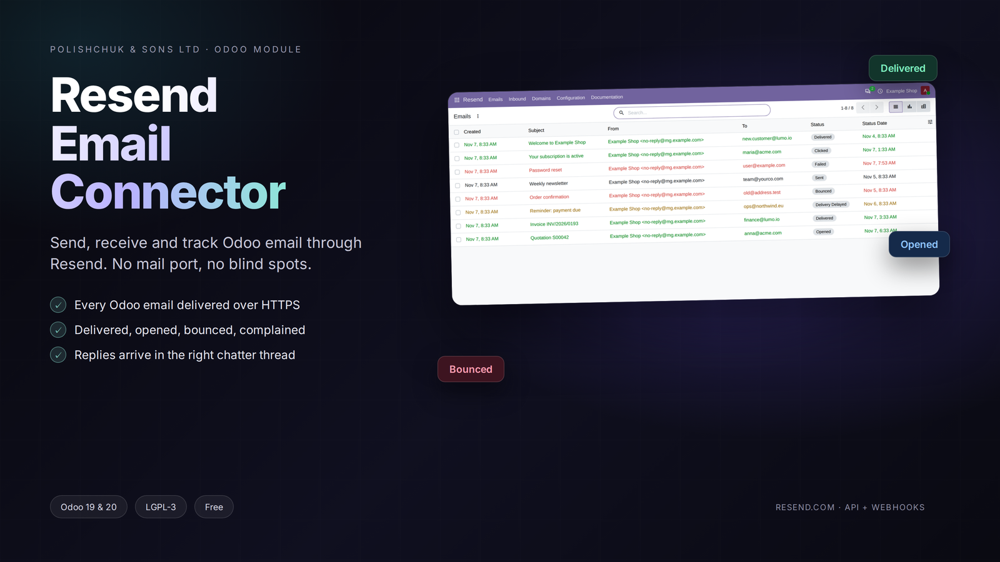
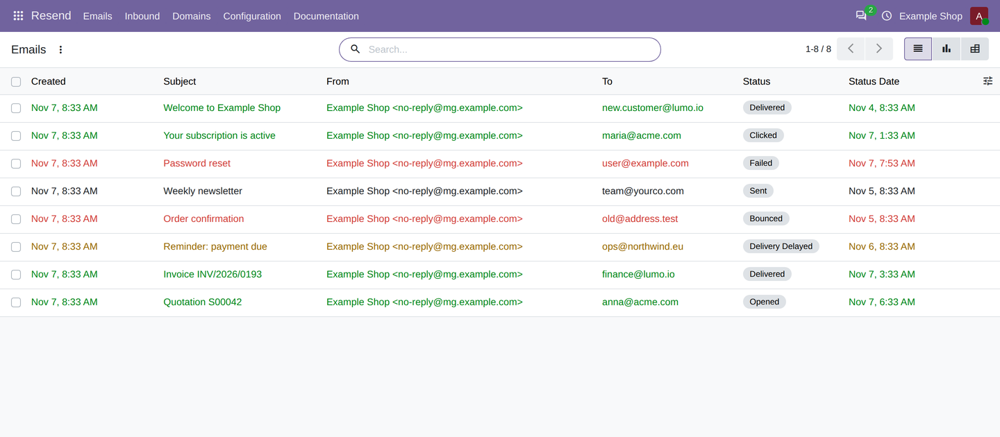
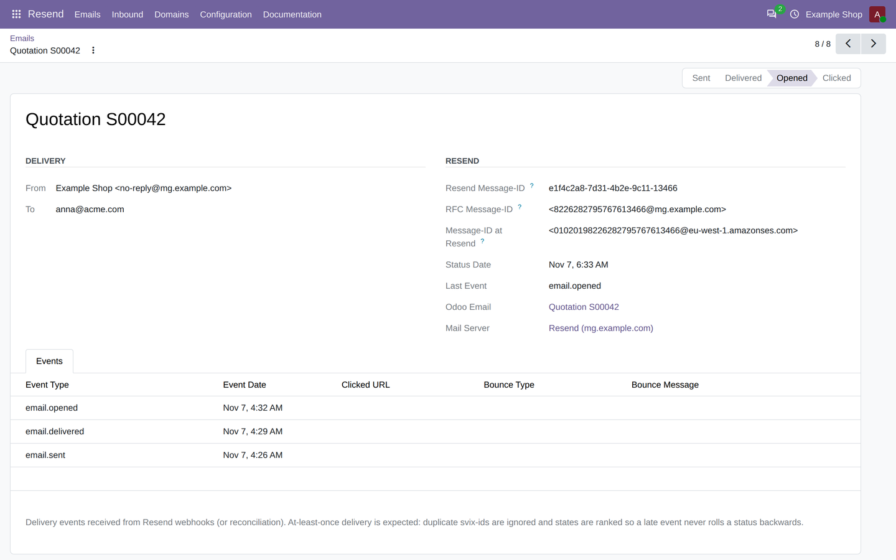

# Resend Email Connector

Odoo module that sends email through [Resend](https://resend.com), receives
incoming mail from Resend and keeps the delivery status of every message in Odoo.

* Author: POLISHCHUK & SONS LTD
* Website: [https://rex.cy](https://rex.cy)
* Support: info@rex.cy
* License: LGPL-3.0
* Odoo versions: 19.0 and 20.0 (Community and Enterprise)
* Depends on: mail (the requests library ships with Odoo)

## Overview

Odoo prepares email as usual: templates, quotations, invoices, chatter
notifications, mass mailings, attachments, Bcc and alias domains. The module
replaces only the transport. Instead of opening an SMTP connection, the message is
posted to the Resend API, and every delivery event Resend reports is written back
to the original Odoo record.

This solves three common problems:

* hosting providers often block ports 25, 465 and 587, which stops Odoo email;
* SMTP only confirms that a server accepted the message, so nobody knows whether
  it was delivered, opened or rejected;
* replies stay in a mailbox instead of the Odoo record they belong to.

## Screenshots

## Features

* Sending through Resend for all Odoo email, with a switch per outgoing server and
  a global on/off switch in the settings.
* A delivery status for each message: sent, delivered, delivery delayed, opened,
  clicked, bounced, complained, failed. Statuses are ranked so a late webhook does
  not move a message backwards.
* Incoming mail is processed by Odoo's own mail gateway, so replies appear in the
  chatter, aliases and catchall keep working and attachments are stored normally.
* A Resend section in Odoo with Emails, Inbound, Domains, Webhook Events, Delivery
  Events, Settings and Documentation.
* Domain management: register a domain, display SPF, DKIM and MX records, verify
  it and synchronise the status.
* Webhook management from the settings screen, with automatic signing secret
  storage and signature verification for every call.
* Automatic retries for transient Resend errors, with the Resend error message kept
  on the failed message.
* Rate limiting that keeps mass mailings below the Resend limit of 10 requests per
  second.
* Russian translation of the user interface.

## Installation

1. Copy the resend_connector folder into an addons directory.
2. Restart Odoo, open Apps and update the apps list.
3. Install "Resend Email Connector".
4. Open Settings > Discuss > Resend.

With Docker:

    # add the folder as a volume in docker-compose.yml
    volumes:
      - ./resend_connector:/mnt/extra-addons/resend_connector

    docker compose exec odoo odoo -d odoo -i resend_connector --stop-after-init

## Configuration

The complete guide is shipped with the module:

* doc/USER_GUIDE.md (English)
* doc/USER_GUIDE.ru.md (Russian)
* Resend > Documentation inside Odoo

Short version:

1. Create an API key in Resend. A key with sending access is enough to send;
   domain and webhook management from Odoo needs full access.
2. Add the domain in Resend > Domains, publish the DNS records shown on the form
   and click Verify Now.
3. In Settings > Discuss > Resend, enter the API key and a From address on the
   verified domain.
4. Open Settings > Technical > Outgoing Mail Servers, tick "Use Resend API" on the
   server Odoo should use and test the connection.
5. Make Odoo reachable from the internet and click "Create / update webhook in
   Resend" in the settings. The signing secret is stored automatically.
6. Send an email and follow its status in Resend > Emails.

## How it works

Sending:

    Odoo mail.mail.send()
      -> ir.mail_server._connect__()        returns a lightweight Resend session
      -> ir.mail_server.send_email()        builds the Resend payload
      -> POST https://api.resend.com/emails
      -> delivery events come back to /resend/webhook
      -> resend.email and the mail.mail record are updated

Receiving:

    POST /resend/webhook (email.received)
      -> GET /emails/receiving/{id} and the signed raw message
      -> references to the Resend Message-Id are mapped to the Odoo Message-Id
      -> mail.thread.message_process()      Odoo routes the reply to its record
      -> the message appears in the chatter

Resend assigns its own Message-Id to every email, so a reply from a normal mail
client references a value Odoo never saw. The module stores the Message-Id Resend
used and rewrites the incoming headers before handing the message to Odoo.

## Incoming mail

1. Add an MX record for a subdomain, for example reply.example.com, pointing to
   Resend. Use a subdomain when the main domain already has a mail provider.
2. Set Settings > Discuss > Alias Domain to that subdomain.
3. Create a mail alias, for example sales@reply.example.com, or simply reply to an
   email sent from Odoo.
4. Messages that do not match any alias are kept in Resend > Inbound.

Incoming messages count against the Resend quota, like outgoing ones.

## Delivery statuses

| Status | Meaning | Odoo |
|---|---|---|
| Sent | Accepted by the Resend API | Email marked as sent |
| Delivered | Accepted by the recipient server | Notification marked as delivered |
| Delivery delayed | Resend is still retrying | Warning, later statuses are not affected |
| Opened / Clicked | Tracking events | Informational |
| Bounced | Rejected by the recipient server | Email failed, notification bounced |
| Complained | Marked as spam by the recipient | Notification cancelled |
| Failed | Quota, invalid data, blocked attachment | Email failed with the reason |

Bounced, complained and failed are final states. Complained takes precedence over
bounced, and bounced over failed.

## Tests

The module contains 46 tests that cover the HTTP client, the webhook signature
(including the published Svix test vector), the outgoing payload, the delivery
state machine and inbound routing. Run them with:

    odoo -d odoo -u resend_connector --test-tags /resend_connector --stop-after-init

## Troubleshooting

* "Mail Delivery Failed": open the email and read the failure reason. It contains
  the Resend error, for example domain is not verified, invalid_api_key or
  daily_quota_exceeded.
* No status updates: check Resend > Configuration > Webhook Events. If the list is
  empty, the webhook is not configured or Odoo is not reachable from the internet.
* Webhook answers 401: the signing secret does not match, or the server clock is
  off by more than five minutes.
* Replies not in the chatter: check the MX record, the email.received
  subscription, the alias domain and the Inbound list.
* Mass mailing seems slow: Resend allows 10 requests per second per team. The
  module limits itself to 8 and retries the requests that hit the limit.

## Compatibility

The module extends ir.mail_server, mail.mail and res.config.settings and adds its
own models. It does not patch other modules or replace their views, so custom
modules and themes keep working. Emails can stay on SMTP per server: tick "Use
Resend API" only where it is needed.

Odoo 19 and 20 differ in the configuration parameter API and in the security rules
model. Both differences are handled by models/compat.py and by the ACL creation in
code, so the same module runs on both versions.

## Folder layout

    resend_connector/
      controllers/main.py          signed webhook and documentation page
      data/ir_cron.xml             webhook queue, domain sync, retries, housekeeping
      doc/                         user guide in English and Russian
      models/
        resend_client.py           HTTP client, retries, rate limit, Svix check
        resend_connector.py        configuration and client factory
        resend_email.py            delivery tracking and state machine
        resend_email_event.py      event log
        resend_webhook_event.py    webhook log, dispatch and inbound processing
        resend_domain.py           domains and DNS records
        ir_mail_server.py          Resend transport
        mail_mail.py               tracking fields on mail.mail
        res_config_settings.py     Settings > Discuss > Resend
        compat.py                  Odoo 19 and 20 differences
      security/                    access group
      static/description/          icon and store description
      tests/                       46 tests
      views/                       screens, menus and the documentation page
      wizard/                      test email wizard

## License

LGPL-3.0. Resend is a third party service; the module only uses its public API.